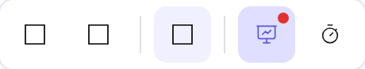
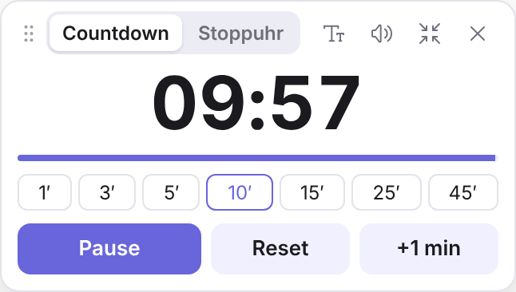
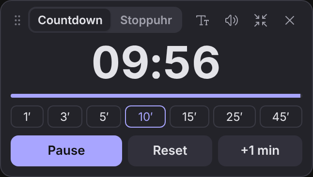
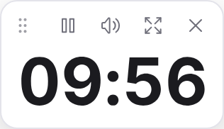
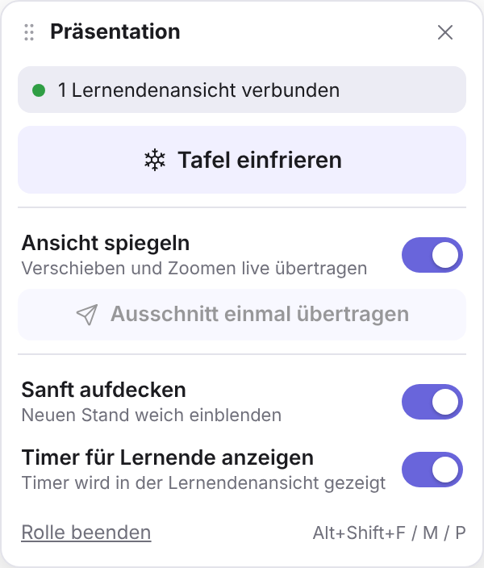
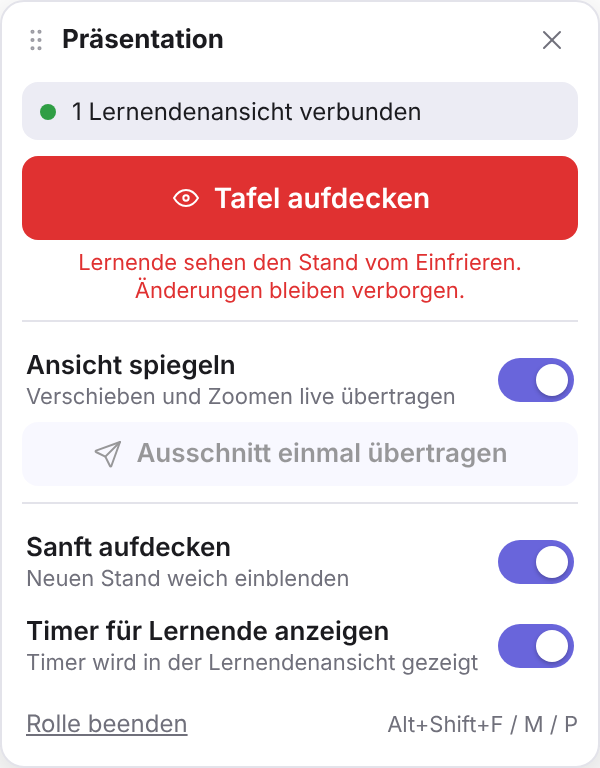
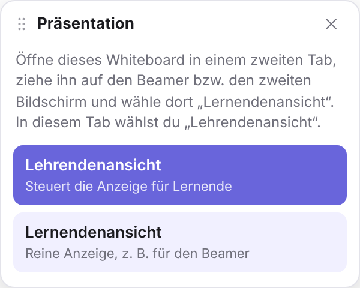
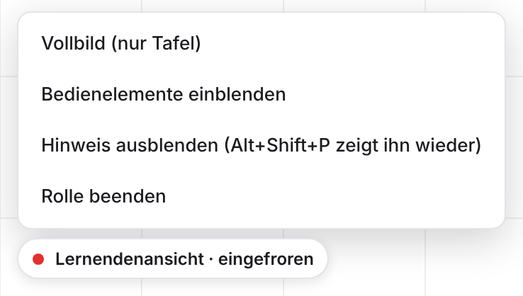

# Seafile Excalidraw Teacher Tools

Erweiterungen für das Excalidraw-Whiteboard in **Seafile Community Edition 13**, gedacht vor allem für den
Einsatz als digitale Tafel im Unterricht:

- **Timer:** verschiebbares Overlay mit Countdown und Stoppuhr
- **Präsentationsmodus:** getrennte **Lehrendenansicht** (dein Bildschirm) und **Lernendenansicht** (Beamer).
  Die Tafel lässt sich für Lernende einfrieren, um unbemerkt vorzubereiten, und die Ansicht lässt sich wahlweise spiegeln.

Zwei zusätzliche Buttons in der oberen Excalidraw-Leiste öffnen die Funktionen.

<p>
  
</p>
<p>
  
  
  
</p>

Die Installationsanleitung ist auf **Unraid + Seafile-Docker-Container + SeaDoc per Compose Manager Plus**
zugeschnitten, funktioniert aber mit jedem Docker-Setup auf Basis von `seafileltd/seafile-mc`.

> Dies ist ein Community-Projekt und steht in keiner Verbindung zu Seafile Ltd. oder dem Excalidraw-Projekt.

> **Vibe-coded mit Claude:** Code, Installer und Anleitung hat [Claude](https://claude.ai) (Anthropic) im Dialog
> geschrieben. Idee, Anforderungen, Tests auf einer echten Seafile-Installation und Feedback kommen von
> [berlinstold](https://github.com/berlinstold).

**English summary:** Classroom add-ons for the Excalidraw whiteboard in Seafile CE 13: a draggable timer
overlay (countdown/stopwatch) and a presenter mode with separate teacher and student views of the same board
in two browser tabs. The teacher can freeze the student view (to prepare content unnoticed) and mirror the
viewport (pan/zoom) to the student screen. Tabs talk via `BroadcastChannel`, no server changes needed. The
script is injected into Seahub via `sub_filter` in the nginx inside the Seafile container
(`./install.sh install <container>`) or used as a Tampermonkey userscript. UI and docs are in German.

## Kompatibilität

| Komponente | Getestet mit |
|---|---|
| Seafile | Community Edition 13.0.24 (Docker, `seafileltd/seafile-mc`) |
| SeaDoc | separater Compose-Stack, keine Änderung nötig |
| Host | Unraid |
| Browser | aktuelle Chromium-, Firefox- und Safari-Versionen |

## Funktionen

- **Timer-Button in der oberen Excalidraw-Leiste** (rechts neben den Formwerkzeugen, durch einen Trennstrich abgesetzt)
- **Verschiebbares Overlay**: an beliebiger Stelle des Panels anfassen und ziehen; die Position wird gespeichert
- **Countdown** mit Schnellwahl (1, 3, 5, 10, 15, 25, 45 Minuten), **+1 min**, Pause/Weiter, Reset
- **Zeit direkt eingeben**: im pausierten Countdown auf die Zeitanzeige klicken und z. B. `5`, `2:30`, `1:15:00`, `1h 30m` oder `90s` eingeben, dann Enter
- **Stoppuhr**
- **Alarm** bei Ablauf: Signalton (abschaltbar über das Lautsprecher-Symbol) und rot blinkendes Panel; Klick aufs Panel bestätigt
- **4 Schriftgrößen** (Schriftgrößen-Symbol), z. B. groß für Präsentationen am Beamer
- **Kompaktmodus** (Verkleinern-Symbol): nur Zeit und Start/Pause
- **Hell/Dunkel** folgt automatisch dem Excalidraw-Theme
- **Tastenkürzel** `Alt + Shift + T` öffnet bzw. schließt das Overlay
- Laufende Timer bleiben bei einem Neuladen der Seite erhalten

**Wichtig zu wissen:** Der Timer läuft **lokal im Browser** jedes Nutzers. Er wird nicht mit anderen
Teilnehmern einer gemeinsamen Whiteboard-Sitzung synchronisiert und nicht in der `.exdraw`-Datei gespeichert.

---

## Präsentationsmodus: Lehrenden- und Lernendenansicht

Du öffnest dasselbe Whiteboard zweimal im selben Browser: einen Tab auf deinem Bildschirm, einen zweiten Tab
(am besten in einem eigenen Fenster) auf dem Beamer bzw. dem erweiterten Bildschirm. Seafile synchronisiert
den Inhalt wie gewohnt. Das Plugin steuert, *was* die Lernenden sehen und *wann*.

<p>
  
  
</p>

### Einrichten (einmal pro Unterrichtsstunde)

1. Whiteboard öffnen und in der Leiste auf das **Präsentations-Symbol** (Bildschirm mit Kurve) klicken.
2. **„Lehrendenansicht“** wählen.
3. Dasselbe Whiteboard in einem **neuen Fenster** öffnen (z. B. Adresse kopieren, Strg+N, einfügen), das Fenster
   auf den Beamer ziehen, wieder auf das Präsentations-Symbol klicken und **„Lernendenansicht“** wählen.
4. In der Lernendenansicht unten links auf den Hinweis klicken und **„Vollbild (nur Tafel)“** wählen.
   Dann sind Seafile-Kopfzeile und Browserleisten verschwunden.

Die Rolle merkt sich jeder Tab, auch nach einem Neuladen. Im Steuerpanel siehst du, ob eine Lernendenansicht
verbunden ist.

<p></p>

### Funktionen der Lehrendenansicht

| Funktion | Wirkung | Kürzel |
|---|---|---|
| **Tafel einfrieren / aufdecken** | Die Lernendenansicht zeigt ein Standbild. Du kannst unbemerkt zeichnen, verschieben und löschen, auch dein Mauszeiger ist nicht zu sehen. Beim Aufdecken erscheint der aktuelle Stand. | Alt+Shift+F |
| **Ansicht spiegeln** | Verschieben und Zoomen werden live übertragen. Die Lernendenansicht zeigt immer mindestens deinen ganzen Ausschnitt, umgerechnet auf ihr Bildformat. | Alt+Shift+M |
| **Ausschnitt einmal übertragen** | Überträgt den aktuellen Ausschnitt einmalig, wenn das Spiegeln aus ist. | |
| **Sanft aufdecken** | Blendet den neuen Stand weich ein statt hart umzuschalten. | |
| **Timer für Lernende anzeigen** | Der Timer erscheint groß in der Lernendenansicht, nur als Anzeige. Bedient wird er in der Lehrendenansicht, seine Position wird relativ übernommen. | |
| Panel öffnen/schließen | | Alt+Shift+P |

### Lernendenansicht

- Reine Anzeige: Excalidraw läuft im Ansichtsmodus, die Bedienelemente sind ausgeblendet. Ein versehentlicher
  Klick am Beamer verändert nichts.
- Unten links zeigt ein dezenter Hinweis den Zustand („verbunden“, „eingefroren“, „Lehrendenansicht nicht verbunden“).
  Ein Klick darauf öffnet ein Menü mit Vollbild, Bedienelementen, Ausblenden des Hinweises und „Rolle beenden“.
- Wird die Lernendenansicht während des Einfrierens neu geladen, zeigt sie eine leere Fläche („Tafel pausiert“)
  statt des verborgenen Stands.
- Wird die Lehrendenansicht geschlossen, während die Tafel eingefroren ist, bleibt die Lernendenansicht
  eingefroren. Über das Menü kann sie dann mit **„Jetzt aufdecken“** freigegeben werden.

<p></p>

### Gut zu wissen

- Beide Tabs müssen **im selben Browser und Browserprofil** laufen. Die Tabs verständigen sich direkt im Browser
  (`BroadcastChannel`), nicht über den Server.
- Mehrere Lernendenansichten gleichzeitig sind möglich, etwa Beamer und zweiter Monitor.
- Fürs **Spiegeln** liest das Plugin die Ansicht direkt aus der internen Excalidraw-Komponente, weil Seafile
  dafür keine offizielle Schnittstelle bietet. Nach einem Seafile-Update mit neuer Excalidraw-Version kann
  das ausfallen. Das Panel zeigt das dann an. Einfrieren und Timer funktionieren unabhängig davon weiter.
- Ist die Tafel nicht eingefroren, sehen die Lernenden deinen Mauszeiger als Teilnehmer-Cursor, wie bei
  jeder gemeinsamen Excalidraw-Sitzung.

---

## Wie das „Plugin“ funktioniert

Seafile CE hat **keine offizielle Plugin-Schnittstelle** für den Excalidraw-Editor. Das Plugin ist deshalb
ein eigenständiges JavaScript (`excalidraw-timer.js`), das in die Seafile-Weboberfläche eingebunden wird.
Es wartet, bis auf einer Seite ein Excalidraw-Editor auftaucht, und fügt dann Buttons und Overlays hinzu.
Auf allen anderen Seafile-Seiten tut es nichts.

Es gibt drei Wege, das Skript einzubinden:

| Variante | Wo | Für wen | Aufwand |
|---|---|---|---|
| **A (empfohlen)** | nginx **im** Seafile-Container | alle Nutzer, automatisch | Skript ausführen, fertig |
| **B** | dein externer Reverse Proxy (NPM, SWAG …) | alle Nutzer | mittel |
| **C** | Browser-Erweiterung (Tampermonkey) | nur dein eigener Browser | sehr gering, kein Server-Eingriff |

**SeaDoc** (dein Compose-Stack) muss für keine der Varianten geändert werden.

---

## Inhalt des Repositorys

| Datei | Zweck |
|---|---|
| `excalidraw-timer.js` | Das eigentliche Plugin (gleichzeitig als Userscript nutzbar) |
| `install.sh` | Automatische Installation, Aktualisierung und Deinstallation für Variante A |
| `nginx-snippet.conf` | Die nginx-Ergänzungen zum manuellen Einfügen |
| `CHANGELOG.md` | Änderungen je Version |
| `docs/images/` | Screenshots für diese Anleitung |

---

## Variante A – Automatische Installation (empfohlen)

Der offizielle Seafile-Container (`seafileltd/seafile-mc`) enthält einen eigenen nginx, der die Weboberfläche
(Seahub) ausliefert. In dessen Konfiguration wird das Skript per `sub_filter` in jede Seite eingebunden.
Je nach Image-Version liegt die Konfiguration im Datenvolume (`/shared/nginx/conf/…`) oder nur im Container
(`/etc/nginx/sites-enabled/…`). Der Installer findet die richtige Datei selbst, indem er den laufenden nginx fragt.

### 1. Dateien auf den Unraid-Server holen

Im Unraid-WebUI oben rechts das **Terminal** (`>_`) öffnen und das Repository als ZIP herunterladen.
Unraid bringt `git` nicht von Haus aus mit, `wget` und `unzip` schon.

```bash
cd /mnt/user/appdata
wget -O teacher-tools.zip https://github.com/berlinstold/seaf-excalidraw-teacher-tools/archive/refs/heads/main.zip
unzip -q -o teacher-tools.zip && rm teacher-tools.zip
mkdir -p seaf-excalidraw-teacher-tools
cp -r seaf-excalidraw-teacher-tools-main/. seaf-excalidraw-teacher-tools/ && rm -rf seaf-excalidraw-teacher-tools-main
chmod +x seaf-excalidraw-teacher-tools/install.sh
```

Für ein **Update** dieselben Befehle erneut ausführen, danach `./install.sh update <container>`.

Mit installiertem `git` (z. B. über das Plugin *NerdTools*) geht es auch so:

```bash
cd /mnt/user/appdata
git clone https://github.com/berlinstold/seaf-excalidraw-teacher-tools.git   # erstes Mal
cd seaf-excalidraw-teacher-tools && git pull                                  # Updates
```

### 2. Containernamen herausfinden

```bash
docker ps --format '{{.Names}}\t{{.Image}}' | grep -i sea
```

Gesucht ist der Container mit dem Image `seafileltd/seafile-mc` (häufig heißt er `seafile` oder `Seafile`).
Der SeaDoc-Container (`seafileltd/sdoc-server`) ist **nicht** gemeint.

### 3. Installer ausführen

```bash
cd /mnt/user/appdata/seaf-excalidraw-teacher-tools
chmod +x install.sh
./install.sh install seafile      # "seafile" durch deinen Containernamen ersetzen
```

Das Skript

1. ermittelt, wo das `/shared`-Volume des Containers auf dem Host liegt (z. B. `/mnt/user/appdata/seafile`),
2. fragt den nginx im Container, welche Konfigurationsdatei die Seahub-Weiterleitung (`127.0.0.1:8000`) enthält,
3. kopiert `excalidraw-timer.js` nach `<shared>/plugins/`,
4. legt ein **Backup** der nginx-Konfiguration unter `<shared>/plugins/backup/` an,
5. fügt die Plugin-Zeilen ein (mehrfaches Ausführen erzeugt keine Dubletten),
6. prüft die Konfiguration mit `nginx -t` – bei einem Fehler wird das Backup automatisch zurückgespielt,
7. lädt nginx im Container neu (kein Neustart von Seafile nötig).

> **Meldung „Die Datei liegt NICHT im /shared-Volume“:** Das ist bei Seafile 13 normal. Die Änderung wirkt sofort,
> geht aber verloren, wenn Unraid den Container neu erstellt (Image-Update, Template bearbeiten). Dann einfach
> `./install.sh install <container>` erneut ausführen. Die Plugin-Datei selbst liegt im Volume und bleibt erhalten.
> Wer das automatisieren möchte, legt im Unraid-Plugin **User Scripts** ein Skript mit dieser Zeile an und lässt es
> z. B. stündlich laufen. Der Installer ist idempotent, ein mehrfaches Ausführen schadet also nicht.

### 4. Testen

1. Ein Whiteboard (`.exdraw`) in Seafile öffnen bzw. neu anlegen.
2. Seite einmal hart neu laden: **Strg + F5** (Mac: Cmd + Shift + R).
3. In der oberen Leiste erscheint rechts ein **Stoppuhr-Symbol**. Ein Klick öffnet das Overlay.

### Aktualisieren / Entfernen

```bash
./install.sh update seafile      # nach dem Herunterladen einer neuen Version (Schritt 1 wiederholen)
./install.sh uninstall seafile   # entfernt Plugin-Datei und nginx-Zeilen wieder
./install.sh diagnose seafile    # zeigt Volumes und nginx-Dateien an, ändert nichts
```

---

## Variante A – Manuelle Installation (ohne Skript)

1. **Host-Pfad des Datenvolumes ermitteln:**

   ```bash
   docker inspect -f '{{range .Mounts}}{{.Source}} -> {{.Destination}}{{"\n"}}{{end}}' seafile
   ```

   Die Zeile mit `-> /shared` zeigt den Host-Pfad, im Folgenden `<SHARED>` (z. B. `/mnt/user/appdata/seafile`).

2. **Plugin-Datei ablegen:**

   ```bash
   mkdir -p <SHARED>/plugins
   cp excalidraw-timer.js <SHARED>/plugins/
   ```

3. **nginx-Konfiguration finden, sichern und bearbeiten:**

   ```bash
   # welche Datei enthält die Seahub-Weiterleitung?
   docker exec seafile sh -c "nginx -T 2>/dev/null | grep '# configuration file'"
   docker exec seafile grep -l '127.0.0.1:8000' /etc/nginx/sites-enabled/*

   # Datei herauskopieren, bearbeiten, zurückkopieren (Beispielpfad)
   docker cp seafile:/etc/nginx/sites-enabled/seafile.nginx.conf /tmp/seafile.nginx.conf
   cp /tmp/seafile.nginx.conf <SHARED>/plugins/seafile.nginx.conf.bak
   nano /tmp/seafile.nginx.conf
   docker cp /tmp/seafile.nginx.conf seafile:/etc/nginx/sites-enabled/seafile.nginx.conf
   ```

   Liegt die Datei bei dir im Volume (`<SHARED>/nginx/conf/seafile.nginx.conf`), kannst du sie direkt auf dem Host bearbeiten.

   Die beiden Blöcke aus `nginx-snippet.conf` einfügen:
   - den Block `location /seafile-plugins/ { … }` innerhalb von `server { … }`, z. B. direkt vor `location / {`
   - die vier Zeilen `proxy_set_header Accept-Encoding …`, `sub_filter_once …`, `sub_filter …` an den Anfang von `location / { … }`

4. **Prüfen und neu laden:**

   ```bash
   docker exec seafile nginx -t && docker exec seafile nginx -s reload
   ```

---

## Variante B – Einbindung im externen Reverse Proxy

Nur nötig, wenn dein Seafile-Container **keinen** internen nginx hat (der Installer meldet das) oder du
Konfigurationsdateien des Containers nicht anfassen möchtest.

1. `excalidraw-timer.js` so ablegen, dass dein Proxy sie ausliefern kann, z. B. im Proxy-Container unter
   `/data/plugins/` (dafür ein zusätzliches Volume-Mapping im Unraid-Template des Proxys anlegen).
2. In der Proxy-Konfiguration für die Seafile-Domain dieselben Zeilen wie in `nginx-snippet.conf` ergänzen,
   wobei `alias` auf den Pfad im **Proxy**-Container zeigt.

**Hinweis zu Nginx Proxy Manager:** NPM setzt in seinen Locations eigene `proxy_set_header`-Zeilen.
Ein `proxy_set_header Accept-Encoding "";` im Feld *Advanced* (Server-Ebene) wird dadurch wirkungslos, und
`sub_filter` greift dann nicht, sobald Seafile komprimiert antwortet. Bei NPM ist Variante A oder C deshalb meist
der einfachere Weg.

Danach mit Strg + F5 testen.

---

## Variante C – Nur für dich: Userscript im Browser

Ganz ohne Änderung am Server:

1. Die Browser-Erweiterung **Tampermonkey** oder **Violentmonkey** installieren.
2. Im Dashboard der Erweiterung ein neues Skript anlegen und den kompletten Inhalt von `excalidraw-timer.js` einfügen.
3. Im Kopf die Zeile
   ```
   // @match        https://seafile.example.com/*
   ```
   auf deine Seafile-Adresse ändern, z. B. `https://cloud.meinedomain.de/*` oder `http://192.168.1.10:8080/*`.
4. Speichern und das Whiteboard neu laden.

Diese Variante funktioniert unabhängig davon, wie Seafile und SeaDoc intern ausgeliefert werden. Sie eignet
sich deshalb auch, um das Plugin zuerst auszuprobieren.

---

## Bedienung des Timers

| Element | Funktion |
|---|---|
| Stoppuhr-Symbol in der Leiste | Overlay öffnen/schließen (roter Punkt = Timer läuft) |
| Panel ziehen (beliebige freie Stelle) | Overlay verschieben |
| **Countdown / Stoppuhr** | Modus wechseln (ein laufender Timer wird dabei pausiert) |
| Zeitanzeige anklicken | Zeit eingeben (nur im pausierten Countdown) |
| 1′ … 45′ | Schnellwahl der Countdown-Dauer |
| **Start / Pause / Weiter** | Timer steuern |
| **Reset** | Auf die eingestellte Dauer bzw. 00:00 zurücksetzen |
| **+1 min** | Eine Minute zum Countdown addieren, auch während er läuft |
| Schriftgrößen-Symbol | Schriftgröße S → M → L → XL |
| Lautsprecher-Symbol | Alarmton an/aus (durchgestrichen = aus) |
| Verkleinern-/Vergrößern-Symbol | Kompakt- bzw. Normalansicht |
| X-Symbol oder `Alt + Shift + T` | Overlay schließen |

Tipp: Ist der Ton aktiv, sollte der Timer einmal per Klick gestartet werden. Browser erlauben Töne erst
nach einer Nutzerinteraktion auf der Seite.

---

## Fehlerbehebung

**Kein Button sichtbar** (In der Lernendenansicht sind die Buttons absichtlich ausgeblendet.)
- Seite hart neu laden (Strg + F5) bzw. den Browser-Cache leeren. Wenn Cloudflare oder ein anderer Cache vor Seafile hängt, dort ebenfalls leeren.
- Prüfen, ob das Skript eingebunden ist: Rechtsklick → *Seitenquelltext anzeigen* → nach `excalidraw-timer` suchen.
- Prüfen, ob die Datei ausgeliefert wird: `https://<deine-seafile-domain>/seafile-plugins/excalidraw-timer.js` im Browser öffnen.
- Erscheint statt des Leisten-Buttons ein **runder schwebender Button unten rechts**, wurde die Leiste nicht erkannt (z. B. in der Mobil-Ansicht oder nach einem Excalidraw-Update mit geänderten Klassennamen). Das Overlay funktioniert trotzdem. Die gesuchten Selektoren stehen oben im Skript in `TOOLBAR_SELECTORS` und lassen sich dort ergänzen.
- Größe, Rundung und Linienstärke des Buttons übernimmt das Skript automatisch vom benachbarten Original-Button der Leiste (z. B. „Weitere Werkzeuge“).

**Präsentation: „Keine Lernendenansicht verbunden“**
- Beide Tabs müssen dasselbe Whiteboard im selben Browser und Browserprofil zeigen. Ein privates Fenster zählt als anderes Profil.
- In der Lernendenansicht muss die Rolle „Lernendenansicht“ gewählt sein (Hinweis unten links).
- Beide Tabs einmal neu laden. Die Rollen bleiben erhalten.

**Präsentation: „Ansicht spiegeln“ ist ausgegraut**
- Das Plugin kommt in dieser Excalidraw-Version nicht an die interne Komponente heran, zum Beispiel nach einem Seafile-Update. Gern ein [Issue](https://github.com/berlinstold/seaf-excalidraw-teacher-tools/issues) mit der Seafile-Version anlegen. Einfrieren und Timer funktionieren weiterhin.

**Skript steht im Quelltext, wird aber nicht ausgeführt**
- Browser-Konsole (F12 → Konsole) auf Fehler oder Hinweise zur Content-Security-Policy prüfen.
- In den Entwicklertools prüfen, ob der Editor in einem `<iframe>` von einem anderen Pfad geladen wird (z. B. `/sdoc-server/…`). Läuft dieser Pfad nicht über den nginx im Seafile-Container, Variante B (Einbindung im Proxy für die ganze Domain) oder Variante C verwenden.

**`nginx -t` meldet `unknown directive "sub_filter"`**
- Dem nginx fehlt das Modul `ngx_http_sub_module`. Der Installer hat in dem Fall das Backup zurückgespielt. Variante B oder C verwenden.

**Nach einem Seafile-Update ist der Button weg**
- `./install.sh install <container>` erneut ausführen. Das Skript ist idempotent und setzt die Zeilen bei Bedarf neu (siehe Hinweis zu „User Scripts“ oben).

**Installer findet keine nginx-Datei**
- `./install.sh diagnose <container>` ausführen. Die Ausgabe zeigt Volumes, die von nginx geladenen Dateien und welche davon Seahub weiterleitet.

**Alles rückgängig machen**
- `./install.sh uninstall <container>` ausführen. Alternativ das Backup aus `<shared>/plugins/backup/` zurückkopieren und `docker exec <container> nginx -s reload` ausführen. Ein Neuerstellen des Containers setzt die Konfiguration ebenfalls zurück, falls sie nicht im Volume liegt.

---

## Anpassen

Oben in `excalidraw-timer.js`:

```js
var PRESETS_MIN = [1, 3, 5, 10, 15, 25, 45];   // Schnellwahl-Buttons in Minuten
var SIZES = ['s', 'm', 'l', 'xl'];             // Schriftgrößen-Stufen
```

Nach einer Änderung die Versionsnummer in der Zeile `// @version` erhöhen und `./install.sh update <container>`
ausführen. Dadurch laden alle Browser die neue Datei statt einer zwischengespeicherten Kopie.

---

## Lizenz

[MIT](LICENSE). Fehlermeldungen und Verbesserungsvorschläge sind über *Issues* willkommen.
